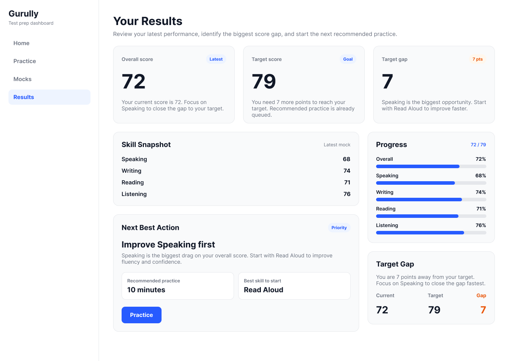

# Gurully — UX Case Study: Test Preparation App

## Project Overview

This project explores a user experience redesign concept for the Gurully test preparation app. The goal is to help learners prepare more confidently by making practice choices clearer, test results easier to understand, and the next learning action easier to identify.

**Project type:** UX/UI Redesign Concept  
**Design focus:** Goal-oriented preparation and actionable test results  
**Design tool:** Figma  
**Project repository:** GitHub

## Project Objective

To explore how a goal-first dashboard and an informative results screen could help learners move from choosing a practice activity to understanding their performance and improving weaker skills.

## 1. Product Audit

### Potential UX Friction Points

**1. Findability**

Learners may find it difficult to locate the right practice mode quickly when preparing for an exam.

**2. Visual Hierarchy**

The next best action may not be immediately obvious, making it harder for learners to decide what to do next.

**3. Feedback and Progress**

Learners may receive a test score but still need clearer guidance on which skills to improve and which practice activity to take next.

### Audit Summary

The redesign explores clearer navigation, more focused information hierarchy, and actionable feedback.

**Note:** These are initial UX hypotheses based on the case-study brief. They have not been validated through user research.

## 2. User Research Questions

The following questions are intended to explore learner goals, preparation habits, and difficulties understanding test performance.

1. What exam are you preparing for, and what score are you aiming to achieve?
2. How do you usually decide which practice activity to start?
3. After completing a mock test, what information do you look at first?
4. What difficulties, if any, do you face when understanding your score and skill breakdown?
5. After identifying a weak skill, how do you decide what to practise next?

**Research status:** These are planned interview questions. Actual learner responses still need to be collected and analysed.

## 3. Research Synthesis

### Three Initial UX Insights

**Insight 1: Learners Need a Clear Goal**

Learners may benefit from seeing their target score and preparation goal prominently so they can focus on relevant activities.

**Insight 2: Scores Should Guide the Next Action**

A score alone may not be enough. Learners need understandable feedback and a useful recommendation for what to practise next.

**Insight 3: Progress Should Be Easy to Discover**

Learners should be able to identify strengths, weak areas, and improvement over time without searching through multiple screens.

### Key Opportunity

Create a focused preparation experience that connects:

**Goal → Practice → Assess → Improve**

**Research status:** These are preliminary hypotheses, not verified findings from actual user interviews.

## 4. Proto-Persona

### Aarav — The Goal-Oriented Test Taker

**Profile:** A hypothetical PTE test taker  
**Goal:** Achieve a target score of 79 or higher  
**Potential frustration:** Too many practice choices  
**Need:** Clear identification of weaker skills and relevant practice  
**Desired outcome:** Understand what to do next and make progress towards the target score.

This proto-persona is a starting assumption from the case-study brief, not a research-validated user profile.

## 5. Problem Statement and How Might We

### Problem Statement

Test takers may have access to multiple preparation features but still struggle to identify the activity that best matches their goals and current performance.

### How Might We Question

How might we guide learners from their target score to relevant practice, useful feedback, and the next learning action with minimal confusion?

## 6. User Flow

### Proposed Happy Path

**Step 1 — Set a Target**

The learner selects an exam, target score, and preparation goal.

**Step 2 — Choose Practice**

The learner selects a relevant practice activity.

**Step 3 — Take a Test**

The learner completes a mock test or practice activity.

**Step 4 — View Results**

The learner reviews the overall score, target-score gap, and individual skill scores.

**Step 5 — Improve**

The learner identifies a weak skill and starts a relevant practice activity.

### Core Journey

**Goal → Practice → Assess → Improve**

### Key UX Principle

The results screen should not become a dead end. It should help learners understand their performance and identify the next useful action.

**Status:** Proposed flow; usability testing is still required.

## 7. Design Priorities and Wireframe Hierarchy

The proposed screen hierarchy focuses on showing the most useful information first.

### Dashboard Hierarchy

1. A clear greeting and preparation goal.
2. The next recommended practice activity.
3. Target score and current progress.
4. Relevant practice and mock-test options.
5. Easy navigation to results and other learning areas.

### Results Screen Hierarchy

1. Overall score and target-score gap.
2. Individual skill scores.
3. Identification of the skill needing the most improvement.
4. A clear recommended practice activity.
5. A prominent action to continue preparation.

This hierarchy is intended to reduce decision effort and make the next action more visible.

**Wireframe status:** A separate low-fidelity wireframe still needs to be created or uploaded to demonstrate the hierarchy before the final UI.

## 8. High-Fidelity UI Design

### Concept 1: Goal-First Dashboard

The dashboard concept focuses on the learner's preparation goal and a recommended next action. It aims to make starting practice easier and reduce the need to search through multiple options.

### Concept 2: Results That Guide Improvement

The results screen concept focuses on the overall score, the gap to the target, individual skill performance, and a possible next practice action.

### Design Rationale

- Emphasise the most important information through visual hierarchy.
- Keep the target score and results easy to identify.
- Connect performance feedback to a possible next action.
- Prioritise clarity and purposeful actions over unnecessary decoration.

These screens are redesign concepts and do not represent changes made to the live Gurully product.

## 9. Prototype and Interaction Plan

The proposed prototype should connect the main preparation moments:

**Dashboard → Practice → Results → Recommended Practice**

The prototype should help evaluate whether learners can:

- Identify the recommended practice activity.
- Understand the relationship between their score and target.
- Identify a skill that needs improvement.
- Find and start the next relevant practice activity.

**Prototype status:** A clickable prototype link still needs to be added if the mentorship submission requires an interactive prototype.

## 10. Usability Testing Plan

The design should be evaluated with approximately 5–8 representative users, as suggested by the case-study brief.

### Proposed Tasks

**Task 1: Start Preparing**

“You need a score of 79 in PTE. Show me how you would start preparing.”

**Measure:** Time taken to identify and start the first practice activity.

**Task 2: Understand Results**

“Your latest score is 72. What would you do next?”

**Measure:** Understanding of the result and ability to identify a next action.

**Task 3: Find Progress**

“Show me how you would check whether your performance is improving.”

**Measure:** Ability to discover progress information.

### Validation Status

These are planned usability tasks. Testing has not yet been conducted, so no usability results or user feedback are claimed.

## 11. Proposed Success Metrics

The redesign could be evaluated using the following measures:

- **Activation:** Time from setting a goal to starting the first practice activity.
- **Engagement:** Repeat practice sessions and mock-test completion.
- **Learning:** Adoption of recommended weak-area practice.
- **Comprehension:** Whether learners correctly understand their scores and skill breakdown.
- **Progress discovery:** Whether learners can locate their performance history.

These are proposed metrics. No measured improvement or business impact is claimed at this stage.

## 12. Limitations and Next Steps

The current work is an early-stage redesign concept. The following activities remain important:

1. Conduct actual user interviews and document responses.
2. Validate the initial UX hypotheses.
3. Create and document low-fidelity wireframes.
4. Build a clickable prototype in Figma.
5. Conduct usability testing and record observations.
6. Refine the design based on evidence.

## Conclusion

This project explores a more guided test-preparation experience by connecting a learner's goal, practice choices, test performance, and next learning action.

The central design idea is to move from simply presenting preparation options and scores towards helping learners understand what to do next.

**Final principle:** Every design decision should address a user need and be evaluated through evidence wherever possible.

---

**Tools:** Figma, GitHub  
**Project status:** Concept UI created; research validation, wireframe documentation, and interactive prototyping remain pending.
